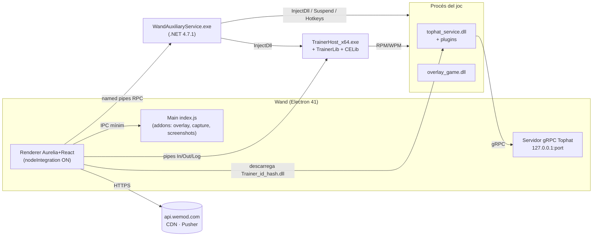

# Anàlisi de referència: WeMod (ara "Wand")

> Fase 0A. Document d'estudi: explica **com funciona** l'aplicació de referència
> per decidir l'arquitectura pròpia. No es reutilitza cap codi, asset, text,
> definició de truc ni marca. Els fitxers analitzats són a `research/`
> (ignorada per git, no es publica mai).

- **Data:** 27/10/2026
- **Versió analitzada:** Wand 12.66.0 (WeMod s'ha rebatejat com a **Wand**)
- **Instal·lació:** `%LOCALAPPDATA%\Wand\app-12.66.0\` (no `%LOCALAPPDATA%\WeMod`)
- **Dades d'usuari:** `%APPDATA%\Wand\` i `%APPDATA%\wemod\` (la carpeta antiga encara existeix)
- **Mètode:** còpia dels fitxers a `research/wemod-extract/orig/`, extracció de
  l'`app.asar` amb `@electron/asar`, anàlisi estàtica amb REA (Reverse Engineer
  Anything) i lectura del JavaScript minificat. **No s'ha executat ni modificat**
  la instal·lació original ni s'ha fet cap petició als seus servidors.

Llegenda de fiabilitat: **[O]** observat directament al codi o als fitxers ·
**[I]** inferència raonable · **[?]** desconegut.

---

## 1. Identificació

| Element | Resultat |
|---|---|
| Tipus | Aplicació **Electron** [O] |
| Electron / Chromium / Node | 41.7.0 / 146.0.7680.216 / 24.15.0 [O] (cadenes del binari) |
| Instal·lador i updates | **Squirrel.Windows** (`Update.exe`, carpetes `app-x.y.z`, `packages/`) [O] |
| Executables d'arrencada | `Wand.exe` (stub de Squirrel) i `WeMod.exe` (stub de compatibilitat) [O] |
| Frontend empaquetat | `resources/app.asar` (52 MB) + `app.asar.unpacked/` per als binaris natius [O] |
| Electron fuses | RunAsNode **off**, `--inspect` **off**, NODE_OPTIONS **off**, integritat de l'ASAR **on**, només carrega des de l'ASAR **on** [O] (REA `ev_6644…aa3f`) |

### Executables auxiliars i mòduls natius (`app.asar.unpacked/static/unpacked/`)

| Carpeta / fitxer | Què és |
|---|---|
| `auxiliary/WandAuxiliaryService.exe` | Servei auxiliar **.NET Framework 4.7.1** (C#, AnyCPU) [O] (REA `ev_5c99…c0`). Fa la feina de sistema: injecció, permisos, processos, hotkeys |
| `auxiliary/GameLauncher.exe` | Llançador de jocs auxiliar [O, funció exacta ?] |
| `trainerlib/TrainerHost_x64.exe` / `_x86` | Procés "hoste" on es carrega el motor de trucs clàssic [O] |
| `trainerlib/TrainerLib_*.dll`, `CELib_*.dll`, `stub/TrainerLib_*.dll` | Motor clàssic. `CELib` suggereix una biblioteca derivada de Cheat Engine [I]. `stub/` és un *decoy* [O] |
| `trainerlib/tophat_service_*.dll` + `*Plugin_*.dll` | Motor nou **"Tophat"**: servei injectat dins el joc amb plugins (TrainerLib, InputCapture, LuaExecutor, ContractRuntime) [O] |
| `overlay/overlay_game*.dll` + `overlay_addon.node` | Overlay dins del joc (hook gràfic) [O] |
| `capture/` | **OBS** (libobs, ffmpeg, x264, Qt6) per a captura de vídeo/clips [O] |
| `native-modules/node-screenshots…node` | Captures de pantalla [O] |
| `preload/ad-view.js`, `rewarded-ad-view.js`, `analytics-frame.js` | Preloads per a anuncis i analítica [O] |

Els trainers de cada joc es descarreguen a `%APPDATA%\Wand\App\trainers\Trainer_<id>_<hash10>.dll`
[O]. Són **DLL natives x64** sense metadades .NET, amb 14 seccions (probablement
empaquetades/protegides) [O/I] (REA `ev_dc0a…49d`).

---

## 2. Frontend

- **Framework de UI:** **Aurelia** (`aurelia-framework`, `aurelia-event-aggregator`, injecció de
  dependències amb `@autoinject`) com a base, amb **React** incrustat per a pantalles noves
  (`shared/react-host`) [O]. Validació amb **Zod** [O]. Tot empaquetat amb **webpack**
  (`webpackChunkWeMod`, centenars de `*.bundle.js` / `*.chunk.js`) [O].
- **Finestres:** dues apps web dins del mateix ASAR: `index.html` (app principal) i
  `overlay.html` (overlay), més `overlay-focus-dot.html` [O]. REA detecta 5 creacions de
  `BrowserWindow` [O] (REA `ev_21ef…dd0`).
- **Estructura per "features"** (Aurelia `.feature(...)`) [O]: `api`, `store`, `native/support`,
  `cheats/storage`, `cheats/trainer`, `installations`, `shared/components`, `shared/react-host`.
- **Textos** a `static/strings/<locale>.json` (16 idiomes) [O].

### Comunicació renderer ↔ procés principal

- Les finestres principals es creen amb `nodeIntegration: true`, `contextIsolation: false`,
  `sandbox: false` [O]. És a dir: **el renderer té Node.js complet** i fa directament
  `child_process.spawn`, `fs`, `net` (named pipes), etc. Gairebé tota la lògica viu al renderer.
- L'IPC d'Electron és mínim: només 3 `ipcMain.handle` literals, tots de l'overlay
  (`ACTION_OVERLAY_BLOCK_INPUT`, `ACTION_OVERLAY_UPDATE_HOTKEY`,
  `ACTION_UPDATE_FOCUS_DOT_SETTINGS`) [O]. Les finestres d'anuncis sí que van aïllades
  (`contextIsolation: true`, `sandbox: true`) [O].
- El procés principal (`index.js`) carrega directament tres addons natius: `capture_addon.node`,
  `overlay_addon.node` i `node-screenshots` [O].

**Lliçó per a nosaltres:** aquest model és pràctic però insegur (qualsevol XSS = execució de
codi amb Node). En Tauri el frontend no té accés al sistema i només pot cridar les comandes
Rust que exposem explícitament.

---

## 3. Motor de trucs

### 3.1 Servei auxiliar (`WandAuxiliaryService.exe`)

- El renderer crea **dos servidors de named pipe** (`\\.\pipe\<nom>`) i llança el servei
  amb `spawn(exe, [nomPipe])`, sense `runas` [O]. Després li envia ordres tipus RPC
  (`run("Ordre", args)`) i se subscriu a esdeveniments (`subscribe("Hotkey", …)`) [O].
- Ordres observades [O]: `GetProcesses`, `InjectDll`, `CreateRemoteThread`, `SuspendProcess`,
  `ResumeProcess`, `WaitForInputIdle`, `GrantFilePermission`, `StatFile`, `ResolvePath`,
  `QueryRegistry`, `GetInstalledPackageId`, `GetFileSignatureInfo`, `ExemptLoopback`,
  `GetGpuDevices`, `GetHardwareSurvey`, `GetProcessPerf`, `IsWindowHidden`, `WriteMiniDump`,
  `AddAvExclusion`, `RunLauncherBypass`, `MountLauncherProxy` / `UnmountLauncherProxy`.
- `GrantFilePermission` dona permisos de lectura/execució als SID *Everyone* (`S-1-1-0`) i
  *AppContainer* (`S-1-15-2-1`) sobre les DLL, perquè jocs UWP/sandboxed les puguin carregar [O].

### 3.2 Generació clàssica: TrainerHost + TrainerLib (named pipes)

Flux observat a `cheats/trainer` [O]:

1. Llança `TrainerHost_<arch>.exe <pidJoc> 1000`.
2. `prepareProcess`: espera `WaitForInputIdle` del joc i, si el trainer ho demana, el **suspèn**.
3. Injecta `TrainerLib_<arch>.dll` (que depèn de `CELib`) al **TrainerHost** i crida l'export `Run`.
   El TrainerLib, des del hoste, opera sobre la memòria del joc.
4. Comunicació app ↔ trainer per tres pipes: `\\.\pipe\WeMod\Trainer_<timestamp>_In`, `_Out`, `_Log` [O].
5. Reprèn el joc.

Hi ha *flags* opcionals `MaskModules` (carrega un `stub/TrainerLib` com a esquer) i
`HideThreads` (fils amb proxy `ExitProcess`) [O]. Són tècniques d'ocultació: **les documentem
però no les reproduirem**.

### 3.3 Generació nova: "Tophat" (gRPC dins del joc)

- L'app aixeca un **servidor gRPC a `127.0.0.1:<port aleatori>`** i escriu el port a
  `%APPDATA%\Wand\service-ports.json` [O].
- Injecta `tophat_service_<arch>.dll` **directament dins del procés del joc** i arrenca el fil
  amb l'export `StartTophatServiceThread` [O]. Aquest servei carrega plugins:
  `TrainerLibPlugin` (trucs), `InputCapturePlugin` (teclat dins del joc),
  `LuaExecutorPlugin` (scripts Lua) i `ContractRuntimePlugin` [O].
- El servei injectat es connecta de tornada al gRPC; per això l'app aplica una **exempció de
  loopback UWP** (`ExemptLoopback`) als jocs de la Microsoft Store [O].
- Missatges binaris (Flatbuffers [I]), *keepalive* i errors tipats (`TophatTrainerError`,
  `ValueSetResult`, `TrainerLogLevel`…) [O]. Detecta motor del joc: `ue`, `unity`, `re` [O].

### 3.4 Com carrega els trainers

1. Catàleg de jocs: `catalog.json` des d'un CDN [O].
2. Per a un joc i versions instal·lades: `GET /v3/games/:gameId/trainer?gameVersions=…&supportedLoaders=artifacts` [O].
3. Binari: `GET /v3/trainer_artifact/:id` (`application/octet-stream`) [O].
4. Es desa primer a `trainers/download/*.tmp` i es renomena a `Trainer_<id>_<hash10>.dll` [O].
   El nom inclou els 10 primers caràcters del hash, que funciona com a clau de memòria cau [O].
   Verificació criptogràfica explícita del contingut: **[?]** (no l'hem trobada al JS; pot ser a
   la capa nativa o al servidor).
5. **Format:** cada trainer és **codi natiu compilat** (una DLL per joc), no una definició
   declarativa. Els valors i trucs arriben per pipe/gRPC amb identificadors.

---

## 4. Detecció de jocs

Mòdul `installations` [O]. Un *provider* per botiga:

| Botiga | Com ho fa |
|---|---|
| Steam | `steamapps/libraryfolders.vdf` + `appmanifest_<id>.acf` (amb els flags d'estat de Steam: UpdateRunning, Uninstalling…) + `librarycache` [O] |
| Epic | Manifests `*.item` (JSON) a `…\Manifests` (camps `InstallLocation`, `CatalogItemId`, `AppName`) [O]. Llança amb `com.epicgames.launcher://apps/<id>?action=launch` [O] |
| GOG | Registre `HKLM\SOFTWARE\GOG.com\Games` i `GalaxyClient\paths\client` (vista 32 bits) [O] |
| Altres | També `uplay`, `origin`/`ea`, `rockstar`, `itch`, `xbox`/`uwp` i `standalone` [O] |

- **Versió del joc:** timestamp de la capçalera PE de l'executable, signatura `.p7x` per a UWP
  o data de fitxers dins de `.zip/.jar` [O]. Aquesta "versió" s'envia a l'API per triar el trainer.
- **Joc en execució:** `GetProcesses` via el servei auxiliar (amb filtre d'arguments) [O],
  comparat amb el catàleg [I].
- **Anti-cheat:** té una regex que busca opcions de llançament que **desactiven** EAC/BattlEye
  ("no easyanticheat", "without battleye", "disable anticheat"…) [O]. No és un bloqueig: serveix
  per trobar maneres d'arrencar el joc sense anti-cheat.

---

## 5. Hotkeys, overlay i servidors

- **Hotkeys:** les captura el **servei auxiliar** (esdeveniment `Hotkey`) [O], probablement amb
  un hook global de teclat [I]. Dins del joc, el `InputCapturePlugin` també captura entrada [O].
  Les hotkeys són configurables per truc (`setCustomHotkey`) [O].
- **Overlay:** injecta `overlay_game[_x64].dll` dins del joc i fa un hook del pipeline gràfic
  (esdeveniments `OverlayGraphicsHooked`, `BitmapTextureFallback`) [O]. Pinta-hi una finestra
  web (`overlay.html`) [I].
- **Servidors** (descriptiu, sense credencials):
  - API REST `api.wemod.com` (`/v3/...`) amb client "infinity" [O].
  - CDN de catàleg i assets; canal d'actualitzacions `…/client/channels/{channel}` [O].
  - Temps real amb **Pusher** [O]. Errors amb **Bugsnag** i telemetria/traces amb **Datadog** [O].
    Analítica i anuncis (Google) [O].
  - `/v3/installed_games` i `/v3/installed_apps`: l'app **informa dels jocs i apps instal·lats** [O].

---

## 6. Diagrama de l'arquitectura detectada

---

## 7. Alternativa pròpia per a cada component

| Component de WeMod | Proposta per a la nostra app | Per què |
|---|---|---|
| Electron + renderer amb Node | **Tauri 2** + React/TS. El frontend només crida comandes Rust tipades | Més lleuger i segur; no cal Node al renderer |
| Servei .NET per named pipes | **Res apart**: el backend Rust de Tauri fa les crides Win32 directament | Un procés menys; Rust ja té accés a la API de Windows (crate `windows`) |
| Trainers = DLL natives injectades | **Definicions JSON declaratives** (`trainers/<game-id>.json`) validades amb Zod/JSON Schema | Editables, revisables, sense compilar; és l'objectiu "afegir trucs propis" |
| Injecció (TrainerHost / Tophat) | **Sense injecció**: lectura/escriptura **externa** amb `OpenProcess` + `ReadProcessMemory` / `WriteProcessMemory` | Cobreix valors, pointer chains, AOB i congelació. Menys risc, menys falsos positius d'antivirus. La injecció queda fora d'abast |
| Lua / ContractRuntime | No a la v1. Si cal lògica, accions declaratives (escriure bytes, sumar, posar valor) | Mantenir-ho simple |
| Ocultació (MaskModules, HideThreads, AV exclusion, launcher bypass) | **No s'implementa** | Fora de l'abast ètic del projecte |
| Regex per saltar anti-cheat | **Al revés**: detectar anti-cheat i **bloquejar** (carpetes `EasyAntiCheat`/`BattlEye`, processos `EasyAntiCheat.exe`, `BEService.exe`, `vgc.exe`, mòduls carregats al joc) + camp `online: true` a la definició | Requisit del projecte |
| Versió per timestamp PE + API | Versió per **SHA-256 de l'executable** i/o `FileVersion` del recurs PE, comparada amb la definició local | Sense servidor |
| Proveïdors Steam/Epic/GOG | Mateixa idea, implementació pròpia en Rust: `libraryfolders.vdf` + `appmanifest_*.acf`, `Manifests\*.item`, registre GOG (crate `winreg`) + afegir `.exe` manual | Formats públics i documentats |
| Hotkeys al servei auxiliar | `tauri-plugin-global-shortcut` (`RegisterHotKey`). Pla B si un joc en pantalla completa se les menja: hook `WH_KEYBOARD_LL` en Rust | Primer l'opció estàndard |
| Overlay injectat (hook gràfic) | **No a la v1**. Opcional més endavant: finestra Tauri transparent *always-on-top* (sense injecció; funciona en finestra/borderless) | Evita tocar el pipeline gràfic |
| Pipes / gRPC app ↔ trainer | Tot és dins del mateix procés Rust; esdeveniments a la UI amb `emit` de Tauri | Menys peces |
| Catàleg remot + API | Fitxers locals; potser un repo Git propi de definicions més endavant | Offline i privat |
| Bugsnag, Datadog, Pusher, anuncis | Res. Logs locals amb `tracing` consultables a la UI | Privacitat |
| Squirrel | Instal·lador de Tauri (NSIS/MSI); updater opcional més endavant | Estàndard de Tauri |

### Electron o Tauri?

**Recomano Tauri 2.** Res del que hem vist necessita Electron: WeMod el fa servir per tenir
Node al renderer i per carregar addons natius, i en el nostre disseny tot això ho fa Rust.
L'únic avantatge d'Electron seria l'overlay amb Chromium dins del joc, que hem deixat fora.

### Permisos

`OpenProcess` amb `PROCESS_VM_READ | PROCESS_VM_WRITE | PROCESS_VM_OPERATION |
PROCESS_QUERY_LIMITED_INFORMATION` funciona **sense administrador** si el joc és de l'usuari
i no s'executa elevat. Només cal elevació si el joc corre com a administrador: l'app ho
detectarà (`ERROR_ACCESS_DENIED`) i explicarà per què cal reiniciar-la elevada. WeMod també
llança el seu servei auxiliar sense `runas` [O].

---

## 8. Limitacions de l'anàlisi

- Anàlisi **només estàtica**. No s'ha observat el trànsit de xarxa ni el comportament en
  execució. Els binaris natius (TrainerLib, tophat, overlay, trainers) no s'han descompilat:
  la seva funció ve dels noms, exports i del codi JS que els crida.
- El JS és minificat; els noms de classes interns no són fiables.
- REA marca discrepàncies d'integritat entre la capçalera de l'ASAR i alguns fitxers
  `unpacked` (OBS, `.node`, DLL de .NET). Probablement són fitxers actualitzats per Squirrel
  després de construir l'ASAR [I]. No afecta les conclusions.
- No s'ha trobat al JS la verificació criptogràfica dels trainers descarregats [?].

### Evidències REA

| ID | Què |
|---|---|
| `ev_66442611ae2a4f5ac296bd46b5212eb04b30ffdbf1ac6bff79615dd30078aa3f` | Fuses d'Electron de `Wand.exe` |
| `ev_21ef05504f1e3e159e96dfeb6e8c05763bbf82425a5e4a0585d88e3613fb6dd0` | Graf de l'app (ASAR): finestres, IPC, preloads |
| `ev_5c99e18fc40c08a2c8fd3e05a1de8caf453c3a47e39c123e0a829d216acf6dc0` | `WandAuxiliaryService.exe` = .NET Framework 4.7.1 |
| `ev_dc0a08257f9438ea18ed257b86b6658942099e4801f2417e80b5d3fd0f88249d` | Trainer descarregat = DLL nativa x64 |
