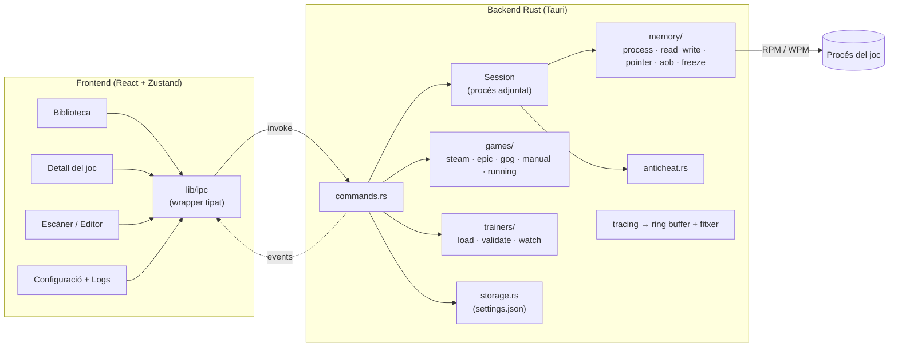
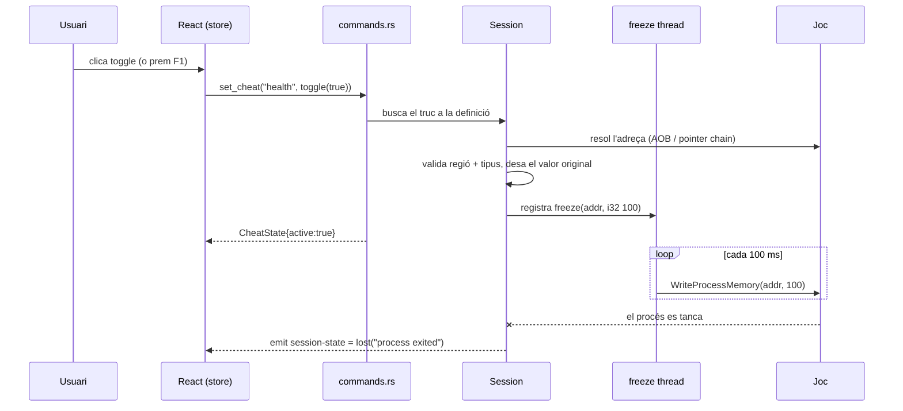

# Pla d'arquitectura — Trainer Lab

> Fase 0B. Es basa en [ANALISI_REFERENCIA.md](ANALISI_REFERENCIA.md). Cal aprovar-lo
> abans de començar la Fase 1.

## 0. Decisions preses

| Tema | Decisió |
|---|---|
| Nom | **Trainer Lab**. Identificador Tauri `cat.trainerlab.app` |
| Shell | **Tauri 2**. No calen Node al renderer ni injecció |
| Accés a memòria | **Extern**: `OpenProcess` + `ReadProcessMemory` / `WriteProcessMemory`. **Sense injecció de DLL** |
| Persistència | **Fitxers JSON** a `%APPDATA%\cat.trainerlab.app\` |
| Validació de definicions | **Rust** (serde estricte + regles pròpies). Se'n genera un **JSON Schema** (`schemars`) per tenir autocompletat a VS Code |
| Tipus TS | Es generen des de Rust (`ts-rs`) a `src/lib/ipc/types/`. Una sola font de veritat |
| Joc de prova | Binari **Rust** dins del mateix *workspace* (`test-game/`) |
| Arquitectures | Jocs **x64 i x86** (WoW64). L'app sempre és x64 |

---

## 1. Visió general



**Principi de seguretat:** el frontend **mai envia adreces arbitràries per escriure** en el
flux normal. Envia `cheatId` + valor, i Rust resol l'adreça a partir de la definició i ho
valida tot. L'única excepció és l'escàner, que només opera sobre la sessió adjuntada i
passa per les mateixes validacions.

---

## 2. Backend Rust (`src-tauri/src/`)

| Mòdul | Responsabilitat |
|---|---|
| `memory/process.rs` | Llistar processos (`CreateToolhelp32Snapshot`). `ProcessHandle` amb `Drop` que tanca el handle. Detectar x86/x64 (`IsWow64Process2`). Llistar mòduls (`TH32CS_SNAPMODULE \| SNAPMODULE32`) |
| `memory/read_write.rs` | `read<T>` / `write<T>` / `read_bytes` / `write_bytes`. Abans d'escriure: `VirtualQueryEx` (regió `MEM_COMMIT`, protecció escrivible, mida dins la regió). Per als *patches* de codi: `VirtualProtectEx` temporal i restaurar |
| `memory/pointer.rs` | Resoldre pointer chains (mida de punter de 4 o 8 bytes segons el joc) |
| `memory/aob.rs` | Parsejar patrons amb comodins (`48 8B ?? 05`) i cercar-los en un buffer o en les regions d'un mòdul. Funció pura testejable |
| `memory/freeze.rs` | Un fil per sessió que reescriu els valors congelats cada *N* ms (100 ms per defecte, configurable) |
| `session.rs` | Estat de l'adjunció: handle, mòduls, adreces resoltes, trucs actius, valors originals per restaurar. Fil vigilant: `WaitForSingleObject(handle)` → quan el joc es tanca, atura la congelació i emet `detached` |
| `anticheat.rs` | Detecció d'anti-cheat abans d'adjuntar (vegeu §5) |
| `games/` | `steam.rs` (`libraryfolders.vdf` + `appmanifest_*.acf`), `epic.rs` (`Manifests\*.item`), `gog.rs` (registre `HKLM\SOFTWARE\WOW6432Node\GOG.com\Games`), `manual.rs`, `running.rs` (sondeig de processos cada 2 s) |
| `trainers/` | Carregar `*.json`, validar, indexar per `id`. En mode desenvolupament, `notify` vigila la carpeta i recarrega (hot-reload) |
| `storage.rs` | `settings.json`: interval de congelació, jocs manuals i hotkeys personalitzades |
| `logging.rs` | `tracing` amb dues sortides: fitxer rotatiu (`tracing-appender`) i un buffer circular en memòria (últimes 2.000 línies) que la UI consulta i rep en directe |
| `commands.rs` | Totes les comandes Tauri. Prima: valida i delega |
| `error.rs` | `AppError` (thiserror) serialitzable, amb `code` estable per a la UI (`ACCESS_DENIED`, `ANTICHEAT_DETECTED`…) |

Crates previstes: `windows`, `serde`/`serde_json`, `schemars`, `ts-rs`, `thiserror`,
`tracing` (+ `tracing-subscriber`, `tracing-appender`), `notify`, `sha2`, `winreg`,
`keyvalues-parser` (VDF), `tauri-plugin-global-shortcut`.

---

## 3. Fluxos de dades React ↔ Rust

### 3.1 Comandes (`invoke`)

| Comanda | Entrada → Sortida | Fase |
|---|---|---|
| `list_processes` | → `ProcessInfo[]` (pid, nom, arquitectura, ruta) | 1 |
| `list_trainers` | → `TrainerSummary[]` + errors de validació per fitxer | 3 |
| `list_games` | → `GameEntry[]` (instal·lats + definicions + manuals + en execució) | 4 |
| `add_manual_game` | ruta `.exe` → `GameEntry` | 4 |
| `attach` | `{ pid, trainerId }` → `SessionInfo` (estat de versió, trucs resolts o fallits) | 2–3 |
| `detach` | → `()` (restaura els patches i atura la congelació) | 2 |
| `set_cheat` | `{ cheatId, input }` → `CheatState`. `input` = `toggle(bool)` \| `value(n)` \| `press` | 3 |
| `set_hotkey` | `{ gameId, cheatId, accelerator }` → `()` | 3 |
| `scan_first` / `scan_next` | `{ type, value?, filter }` → `{ count }` | 5 |
| `scan_results` | `{ offset, limit }` → `ScanHit[]` (adreça, `mòdul+offset` si és estàtica, valor) | 5 |
| `scan_write` | `{ address, type, value }` → `()` (amb validació de regió) | 5 |
| `save_cheat_from_scan` | `{ trainerId, cheat }` → escriu la definició a la carpeta d'usuari | 5 |
| `get_logs` | `{ limit, level? }` → `LogEntry[]` | 1 |
| `get_settings` / `save_settings` | `Settings` | 3 |

Els tipus són structs Rust amb `#[derive(Serialize, Deserialize, TS)]`. `src/lib/ipc/index.ts`
és un wrapper fi del tipus `export const attach = (a: AttachArgs) => invoke<SessionInfo>("attach", a)`.

### 3.2 Esdeveniments (Rust → React, `emit`)

| Esdeveniment | Contingut | Qui l'escolta |
|---|---|---|
| `session-state` | `detached` \| `attaching` \| `attached{…}` \| `lost{motiu}` | store `session` |
| `cheat-values` | valors actuals dels trucs (cada 500 ms mentre la UI hi és) | Detall del joc |
| `running-games` | llista de jocs amb definició que estan en marxa | Biblioteca |
| `trainers-changed` | després d'un hot-reload | store `trainers` |
| `hotkey-fired` | `{ cheatId }` (per al feedback visual) | Detall del joc |
| `log` | `LogEntry` | Configuració → Logs |

### 3.3 Exemple: activar «vida infinita»



Les hotkeys **només es registren mentre hi ha una sessió adjuntada** i es desregistren en
desadjuntar, per no capturar tecles globals quan no cal. Prémer una hotkey crida el mateix
camí que `set_cheat`, des de Rust.

---

## 4. Format de definició de trainers

Fitxer `trainers/<game-id>.json`. Es carreguen de dos llocs: els exemples inclosos a l'app
i `%APPDATA%\cat.trainerlab.app\trainers\`. Si dos fitxers tenen el mateix `id`, guanya el
de l'usuari. L'escàner sempre escriu a la carpeta d'usuari.

### 4.1 Estructura

```jsonc
{
  "$schema": "../schemas/trainer.schema.json",
  "schemaVersion": 1,
  "id": "test-game",                    // [a-z0-9-], únic
  "name": "Trainer Lab Test Game",
  "online": false,                      // true ⇒ l'app es nega a adjuntar-se
  "process": { "executable": "test-game.exe", "arch": "x64" },
  "match": { "steamAppId": null, "epicAppName": null, "gogId": null },
  "versions": [
    { "label": "dev", "sha256": "…", "fileVersion": null }
  ],
  "cheats": [ /* §4.3 */ ]
}
```

### 4.2 Com es localitza una adreça (`address`)

Té un **punt de partida** (mòdul + offset **o** un patró AOB) i, opcionalment, una
**cadena de punters**:

```jsonc
// A) Mòdul + offset estàtic
{ "module": "test-game.exe", "offset": "0x1F2A0", "pointers": ["0x10"] }

// B) Patró AOB: comença on es troba el patró
{ "module": "test-game.exe",
  "aob": { "pattern": "54 4C 41 42 ?? ?? 43 48", "offset": 8 },
  "pointers": ["0x10"] }

// C) AOB sobre una instrucció amb adreçament relatiu a RIP (x64)
//    adreça = coincidència + instrLength + i32 llegit a (coincidència + dispOffset)
{ "module": "game.exe",
  "aob": { "pattern": "48 8B 05 ?? ?? ?? ?? 48 85 C0", "rip": { "dispOffset": 3, "instrLength": 7 } },
  "pointers": ["0x0", "0x48"] }
```

Semàntica de `pointers` (igual que la notació `[[base]+o1]+o2` de Cheat Engine):
`addr = inici; per a cada o a pointers: addr = llegeix_punter(addr) + o`.

Les adreces es resolen **en adjuntar** i es tornen a resoldre si una lectura falla, perquè
els punters canvien quan el joc carrega una partida.

### 4.3 Trucs

Camps comuns: `id`, `name`, `description?`, `category?`, `kind`, `target`
(`{ address, type }`) i `hotkey?`. Tipus de dada (`type`): `i8 i16 i32 i64 u8 u16 u32 u64
f32 f64 bool bytes`.

```jsonc
// Toggle: congela un valor mentre està actiu. En desactivar, restaura l'original (opcional)
{ "id": "health", "name": "Vida infinita", "kind": "toggle",
  "target": { "address": { "...": "..." }, "type": "i32" },
  "on": { "freeze": 100 }, "off": "restore", "hotkey": "F1" }

// Toggle amb patch de codi: escriu bytes. Si els bytes actuals no són `expect`, no fa res.
{ "id": "no-reload", "name": "Sense recàrrega", "kind": "toggle",
  "target": { "address": { "aob": { "...": "..." } }, "type": "bytes" },
  "on": { "patch": "90 90 90", "expect": "FF 4B 10" }, "off": "restore" }

// Slider: l'usuari tria un valor dins del rang. Opcionalment el congela
{ "id": "speed", "name": "Velocitat", "kind": "slider",
  "target": { "address": { "...": "..." }, "type": "f32" },
  "min": 0.5, "max": 5, "step": 0.1, "freeze": true,
  "hotkeys": { "increase": "F6", "decrease": "F5" } }

// Valor: camp numèric + botó «Aplica» (escriptura única)
{ "id": "set-money", "name": "Fixar diners", "kind": "value",
  "target": { "address": { "...": "..." }, "type": "i64" },
  "default": 99999, "min": 0, "max": 2147483647 }

// Botó d'acció: una operació puntual
{ "id": "add-ammo", "name": "+50 munició", "kind": "button",
  "target": { "address": { "...": "..." }, "type": "i32" },
  "action": { "add": 50 }, "hotkey": "F4" }          // add | set | patch
```

### 4.4 Regles de validació (a Rust, abans d'acceptar el fitxer)

- `schemaVersion` conegut. `id` únics dins del fitxer. `type` coherent amb el valor
  (`bytes` només amb `patch`, enters dins del rang del tipus, `min ≤ default ≤ max`).
- `address` té exactament un punt de partida (`offset` o `aob`). Els patrons AOB són
  parsejables, no són només comodins i tenen com a mínim 4 bytes fixos.
- `patch` i `expect` tenen la mateixa longitud. Els offsets són hex `0x…` o decimals.
- Les hotkeys són acceleradors vàlids i no es repeteixen dins del mateix joc.
- Un fitxer invàlid **no tomba l'app**: surt a la Biblioteca amb l'error i la ruta JSON del
  camp (p. ex. `cheats[2].target.address.aob.pattern`).

### 4.5 Versions

En adjuntar es calcula l'SHA-256 de l'executable (i es llegeix el `FileVersion` del PE):

- **Coincideix** amb alguna `versions[]` → estat verd «versió compatible».
- **No coincideix** → estat groc «versió no verificada». Els trucs amb AOB solen funcionar
  igualment. Els *patches* sempre comproven `expect` abans d'escriure.
- **`versions` buit** → estat gris «sense informació de versió».

---

## 5. Anti-cheat i mode online

Abans d'obrir el procés (i, per tant, abans de qualsevol lectura):

1. Si la definició té `online: true` → **bloquejat**.
2. Si el procés té carregat algun mòdul conegut (`EasyAntiCheat*.dll`, `BEClient*.dll`,
   `vgk*`, …) → **bloquejat**. Llistar mòduls no requereix permisos d'escriptura.
3. Si hi ha processos o serveis d'anti-cheat actius al sistema però no dins del joc
   (`EasyAntiCheat*.exe`, `BEService*.exe`, `vgc.exe`, `FACEIT*.exe`, …) → **avís** que cal
   confirmar. *(Decidit a la Fase 2: Vanguard s'executa sempre i bloquejaria l'app sencera.)*
4. Si a la carpeta del joc hi ha `EasyAntiCheat/`, `BattlEye/` o similars → **avís**, i
   l'usuari ha de confirmar que juga en mode offline.

La llista de signatures és a `anticheat.rs` amb tests. Quan es bloqueja, la UI explica el
motiu i no ofereix cap opció per saltar-s'ho.

---

## 6. Permisos

- `OpenProcess` amb `PROCESS_VM_READ | PROCESS_VM_WRITE | PROCESS_VM_OPERATION |
  PROCESS_QUERY_LIMITED_INFORMATION`. Res més.
- Si retorna `ERROR_ACCESS_DENIED` (joc elevat), la UI mostra: «Aquest joc s'executa com
  a administrador. Per modificar-ne la memòria, Trainer Lab també ha de ser administrador»,
  amb un botó per reiniciar-la elevada (`ShellExecuteW` amb `runas`). Mai s'eleva sola.
- El manifest de l'app es queda en `asInvoker`.

---

## 7. Frontend (`src/`)

```
src/
  app/              router (4 pantalles), layout, tema fosc
  components/ui/    Button, Toggle, Slider, NumberInput, StatusBadge, HotkeyInput, Toast
  features/
    library/        llista de jocs, cerca, estat «en execució», afegir .exe
    trainer/        detall del joc: estat de la sessió, versió, trucs, hotkeys
    scanner/        escàner, resultats, desar com a truc
    settings/       configuració + visor de logs
  lib/ipc/          index.ts (invoke tipat) + types/ (generats per ts-rs)
  stores/           session.ts, trainers.ts, games.ts, settings.ts (Zustand)
```

Els *stores* de Zustand són l'única via cap a `lib/ipc`. Els components només llegeixen dels
stores. Els listeners d'esdeveniments es registren un cop, a l'arrencada.

**Indicador d'estat** (sempre visible a la capçalera): joc detectat → adjuntat → versió
(verd / groc / gris) → anti-cheat (vermell si està bloquejat).

---

## 8. Joc de prova (`test-game/`)

Binari Rust de consola, pensat per aprendre:

- `Player { health: i32, ammo: i32, money: i64, speed: f32, name: [u8; 16] }` al *heap*
  (`Box`). Així els valors no tenen adreça fixa, com en un joc real.
- Un `static ANCHOR` `#[repr(C)]` amb un *magic* de 8 bytes (`TLABANCH`) seguit d'un punter
  al `Player`. Això permet demostrar les dues tècniques de forma estable entre compilacions:
  **AOB** (trobar el magic) + **pointer chain** (seguir el punter fins a cada camp).
- Tecles: `D` rep mal, `S` dispara, `B` compra, `Q` surt. Imprimeix els valors (i, amb
  `--debug`, les adreces) a cada torn.
- `trainers/test-game.json` és l'exemple complet i documentat: un truc de cada tipus.

---

## 9. Tests

| Què | Com |
|---|---|
| Parser i validació de definicions | Fitxers JSON vàlids i invàlids a `src-tauri/tests/fixtures/` |
| Pointer chains | Trait `MemorySource` (lectura de bytes), amb una implementació real (RPM) i una de simulada (buffer amb adreça base). Cadenes de 4 i 8 bytes, punter nul i fora de rang |
| AOB | Parser (comodins, errors) i cerca sobre buffers: coincidència al principi o al final, entre fronteres de *chunks*, cap coincidència |
| Validació d'escriptura | Regions simulades (sense commit, només lectura, desbordament) |
| Anti-cheat | Llistes simulades de mòduls, processos i carpetes |
| Detecció de biblioteques | Fixtures de `libraryfolders.vdf`, `.acf` i `.item` |
| Integració (manual + script) | `test-game` + `attach` + `set_cheat`, verificant el valor amb una lectura |

`cargo test` i `npm run typecheck` al final de cada fase.

---

## 10. Fases (revisades)

| Fase | Entrega | Prova de «fet» |
|---|---|---|
| 1 | Workspace Tauri + React + Tailwind + Zustand, `test-game`, `list_processes`, logs a la UI | Es veu `test-game.exe` a la llista, amb la seva arquitectura |
| 2 | `memory/*` (read/write, pointer, aob, freeze), `session`, `detach` en tancar el joc | Tests de pointer i AOB passen. Una comanda de debug llegeix i congela la vida del `test-game` |
| 3 | Format de definicions + JSON Schema + hot-reload, UI del trainer, hotkeys, anti-cheat, estat de versió | `trainers/test-game.json` funciona sencer des de la UI i amb les hotkeys |
| 4 | Biblioteca Steam/Epic/GOG/manual + detecció de jocs en execució | Apareixen els jocs instal·lats; `test-game` es detecta en obrir-lo |
| 5 | Escàner (exacte, canviat/no canviat, augmentat/disminuït) + desar com a truc | Trobar els diners del `test-game` amb l'escàner i desar-los com a truc nou |

A cada fase: `DEVLOG.md` actualitzat i, a la Fase 2, comença `docs/ARCHITECTURE.md` amb les
explicacions de baix nivell (ReadProcessMemory, pointer chains, AOB).

---

## 11. Fora d'abast (v1)

Injecció de DLL, overlay dins del joc, scripts (Lua o similars), escàner de punters
automàtic, descàrrega de definicions remotes, qualsevol tècnica d'ocultació, i jocs amb
anti-cheat o en mode online.
